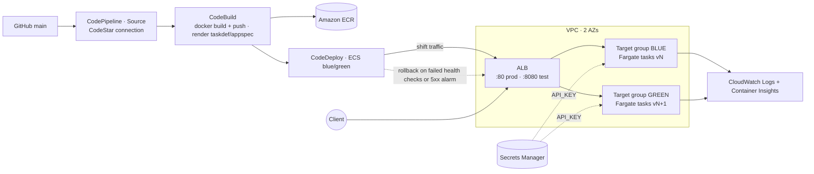

# Containerized App on Amazon ECS Fargate (Blue/Green)

A Dockerized Node.js API on **ECS Fargate** behind an **Application Load Balancer**, delivered by
**AWS CodePipeline → CodeBuild → CodeDeploy blue/green** with **automatic rollback**.
All infrastructure is **Terraform**; secrets come from **AWS Secrets Manager**; logs go to **CloudWatch**.

## Architecture



## What this demonstrates

| Area | Implementation |
|---|---|
| Compute | ECS Fargate in private subnets, Container Insights enabled |
| Networking | VPC across 2 AZs, NAT gateway, ALB in public subnets, tasks reachable only from the ALB security group |
| Releases | CodePipeline (GitHub → CodeBuild → CodeDeployToECS), blue/green with a test listener on :8080 |
| Rollback | Automatic on deployment failure or when the `HTTPCode_Target_5XX_Count` alarm fires; old tasks kept 5 min |
| Scaling | Application Auto Scaling on CPU (60%) and ALB request count per target (200), 2–6 tasks |
| Secrets | API key generated by Terraform, stored in Secrets Manager, injected by ECS; never in code or logs |
| Security | Separate execution and task roles (least privilege), immutable build artifacts in encrypted private S3, ECR scan-on-push, non-root container |
| Observability | Structured JSON logs to CloudWatch (14-day retention), Container Insights metrics |

## Repo layout

```
app/                       Node.js API (/health, /, /notes)
terraform/                 VPC, ALB, ECS, ECR, Secrets Manager, autoscaling, CodeDeploy, CodePipeline
buildspec.yml              CodeBuild: build, push, render taskdef.json + appspec.yaml
deploy/*.template.*        Task definition and AppSpec templates
bootstrap.sh               First-time deploy
.github/workflows/ci.yml   terraform fmt/validate, docker build, template check
```

## Deploy

Prerequisites: AWS CLI (logged in), Terraform ≥ 1.6, Docker.

```bash
cp terraform/terraform.tfvars.example terraform/terraform.tfvars   # set github_repo
./bootstrap.sh                                                       # ~8-10 min
```

Then authorize the GitHub connection once in **AWS Console → Developer Tools → Settings → Connections**
(status must change from *Pending* to *Available*), and click **Release change** on the pipeline.

```bash
URL=$(terraform -chdir=terraform output -raw app_url)
curl $URL/
KEY=$(aws secretsmanager get-secret-value --secret-id ecsfargate-app/api-key --query SecretString --output text)
curl -X POST $URL/notes -H "x-api-key: $KEY" -H 'Content-Type: application/json' -d '{"text":"hello"}'
```

## Try a blue/green release

1. Change something in `app/server.js`, then commit and push.
2. Watch **CodeDeploy → Deployments**: green tasks start, you can test them on `:8080`, then traffic shifts on `:80`.
3. `curl $URL/` shows the new `version` (the git short SHA).

## Try an automatic rollback

Set `"FAIL_HEALTH"` to `"true"` in `deploy/taskdef.template.json` and push. The green tasks fail the ALB health
check, CodeDeploy marks the deployment failed, and traffic stays on blue. Set it back to `"false"` afterwards.

## Load test (autoscaling)

```bash
hey -z 5m -c 50 $URL/        # or: ab -t 300 -c 50 $URL/
```
Watch the desired task count in the ECS console or CloudWatch.

## Screenshots

Add yours to `docs/screenshots/`: a successful pipeline run, CodeDeploy traffic shifting, an automatic rollback, scaling events, and CloudWatch logs.

## Cost and teardown

About **$0.08–0.12/hour** (ALB, NAT gateway, 2 small Fargate tasks). Destroy when done:

```bash
terraform -chdir=terraform destroy
```

## Known limitations / next steps

- The request-count scaling policy is bound to the blue target group; after a switch, production traffic is on green.
  Re-point it in a CodeDeploy lifecycle hook, or rely on CPU scaling only.
- Add HTTPS (ACM + Route 53), WAF, a remote S3/DynamoDB state backend, and a manual approval stage for production.
# ecsfargate-app
